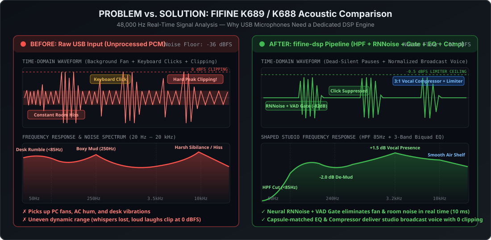
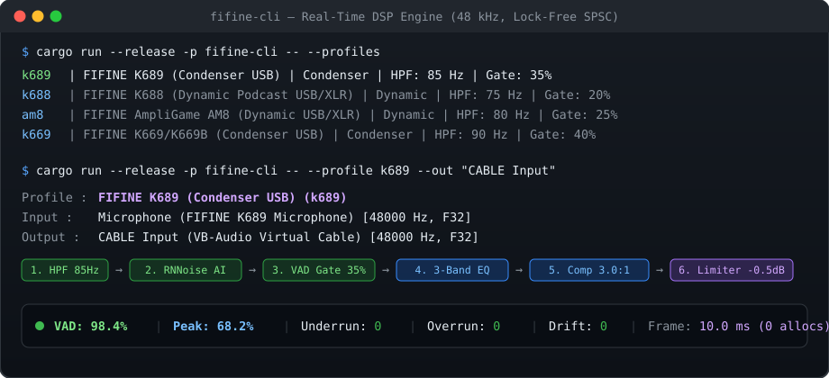

# FIFINE Open Audio Platform (`fifine-dsp`)

[](https://github.com/Takatochi/fifine-dsp/actions/workflows/ci.yml)
[](LICENSE)
[](https://www.rust-lang.org/)

A cross-platform, real-time Digital Signal Processing (DSP) companion engine for **FIFINE USB microphones** (**K689**, **K688**, **AM8**, **K669**) and generic USB Audio Class (UAC) devices on **Windows** and **Linux**.

Built in **Rust** following **Domain-Driven Design (DDD)**, **Hexagonal Architecture (Ports & Adapters)**, and strict **Real-Time Audio Safety** principles (zero heap allocations and zero locks on audio callback threads).

---

## What Problem Does It Solve?

Out of the box, budget and mid-range USB microphones (**FIFINE K689**, **K688**, **AM8**, **K669**) operate as driverless USB Audio Class endpoints with no onboard DSP. As a result:
1. **Condenser capsules (`K689`, `K669`)** are highly sensitive to PC fan hum, air conditioning, mechanical keyboard clicks, room echo, and harsh high-frequency sibilance.
2. **Dynamic capsules (`K688`, `AM8`)** often sound boxy in the `250–350 Hz` range and have wide dynamic swings (quiet speech vs. sudden clipping at `0 dBFS`).
3. **Heavy third-party software suites** (OBS background runners, RTX Voice, or bloated DAW chains) consume excessive CPU/GPU resources or introduce noticeable latency.

`fifine-dsp` solves this by inserting a deterministic, **10 ms low-latency**, zero-allocation Rust DSP pipeline between your physical USB microphone and a virtual output device:



### Real-Time CLI & Telemetry Preview



---

## Key Features

- **Real-Time Neural Denoising:** Powered by `nnnoiseless` (pure Rust port of **RNNoise**) operating on 10 ms frames (480 samples @ 48 kHz).
- **VAD-Driven Smooth Noise Gate:** Uses neural Voice Activity Detection probabilities to eliminate background room hiss between words without abrupt cutoffs.
- **Capsule-Specific Acoustic Profiles:** Built-in domain presets tailored for both **Condenser** (`K689`, `K669`) and **Dynamic** (`K688`, `AM8`) capsules:
  - High-Pass Filter (rumble & desk vibration removal)
  - 3-Band Parametric Biquad EQ (room boominess cut, vocal presence boost, sibilance/air shelf)
  - Vocal Dynamic Compressor & Brickwall Peak Limiter
- **Lock-Free SPSC Audio Routing:** Bridges physical USB microphone inputs to virtual audio outputs (**VB-Cable** on Windows, **PipeWire Virtual Source** on Linux) via a lock-free ring buffer with automatic clock-drift compensation.
- **Extensible via Dependency Injection:** Add new microphone models or inject custom DSP effects (`trait DspNode`) without modifying the core engine.

---

## Architecture Documentation

The complete system architecture, stakeholder concerns, UML class diagrams, real-time concurrency sequence views, invariants, and Architecture Decision Records (ADRs) are documented in compliance with **ISO/IEC/IEEE 42010:2022**:

- **[ISO/IEC/IEEE 42010 Architecture Description](docs/ISO_IEC_IEEE_42010_ARCHITECTURE.md)**

### Workspace Structure

```text
fifine-companion/
├── Cargo.toml
├── docs/
│   └── ISO_IEC_IEEE_42010_ARCHITECTURE.md   # Formal Architecture Specification
└── crates/
    ├── fifine-domain/                       # Pure DDD Core: Entities, Presets, DI Ports (DspNode)
    ├── fifine-dsp/                          # Real-Time DSP Adapters (RNNoise, Gate, Biquad EQ, Dynamics)
    ├── fifine-hal/                          # Hardware Discovery Adapter (cpal / USB endpoint matching)
    ├── fifine-engine/                       # Lock-Free SPSC Real-Time Stream Engine & Telemetry
    └── fifine-cli/                          # CLI Runner & Live Telemetry Monitor
```

---

## Getting Started

### Prerequisites

1. **Rust Toolchain** (`1.75+`): Install via [rustup.rs](https://rustup.rs/) or `winget install Rustlang.Rustup`.
2. **48,000 Hz Sample Rate:** Ensure both your microphone and output virtual cable are set to **48 kHz** in your OS sound settings (required by RNNoise).
3. **Virtual Audio Device (Optional, for routing to Discord / OBS / Zoom):**
   - **Windows:** Install [VB-CABLE Virtual Audio Device](https://vb-audio.com/Cable/). The engine automatically routes processed audio into `CABLE Input`, allowing you to select `CABLE Output` as your microphone in any app.
   - **Linux:** Use PipeWire / PulseAudio virtual sink (`pactl load-module module-null-sink sink_name=fifine_virtual`).

### Build & Run

List all registered microphone domain profiles (`k689`, `k688`, `am8`, `k669`):
```bash
cargo run --release -p fifine-cli -- --profiles
```

List all available physical and virtual audio endpoints on your system:
```bash
cargo run --release -p fifine-cli -- --list
```

Start real-time voice processing (auto-detects your FIFINE microphone and virtual output cable):
```bash
cargo run --release -p fifine-cli
```

Explicitly select a hardware profile (e.g., `k689` or `k688`) and specific input/output devices:
```bash
cargo run --release -p fifine-cli -- --profile k689 --in "FIFINE" --out "CABLE Input"
```

Disable neural denoising while keeping the EQ, Compressor, and Limiter active:
```bash
cargo run --release -p fifine-cli -- --profile k689 --no-rnnoise
```

---

## Extending the Platform

### 1. Adding a Custom DSP Effect (Dependency Injection)
Implement the `fifine_domain::DspNode` trait and inject it into `DspPipelineBuilder`:

```rust
use fifine_domain::{DspNode, ProcessContext};
use fifine_dsp::DspPipelineBuilder;

pub struct SoftSaturator;

impl DspNode for SoftSaturator {
    fn name(&self) -> &'static str {
        "Soft Tape Saturator"
    }

    fn process_frame(&mut self, samples: &mut [f32], _ctx: &mut ProcessContext) {
        for s in samples.iter_mut() {
            *s = s.tanh();
        }
    }
}

let pipeline = DspPipelineBuilder::new(48_000.0)
    .with_node(SoftSaturator)
    .build();
```

### 2. Adding a New Microphone Profile
Add a new `MicrophoneProfile` entry to [`crates/fifine-domain/src/profiles.rs`](crates/fifine-domain/src/profiles.rs) or register it dynamically via `InMemoryProfileRegistry::register_profile()`.

---

## License

Licensed under the **Apache License, Version 2.0** ([LICENSE](LICENSE) or http://www.apache.org/licenses/LICENSE-2.0).
