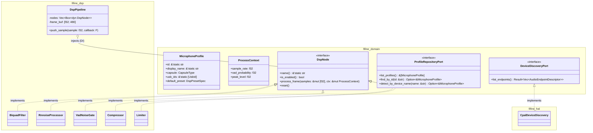
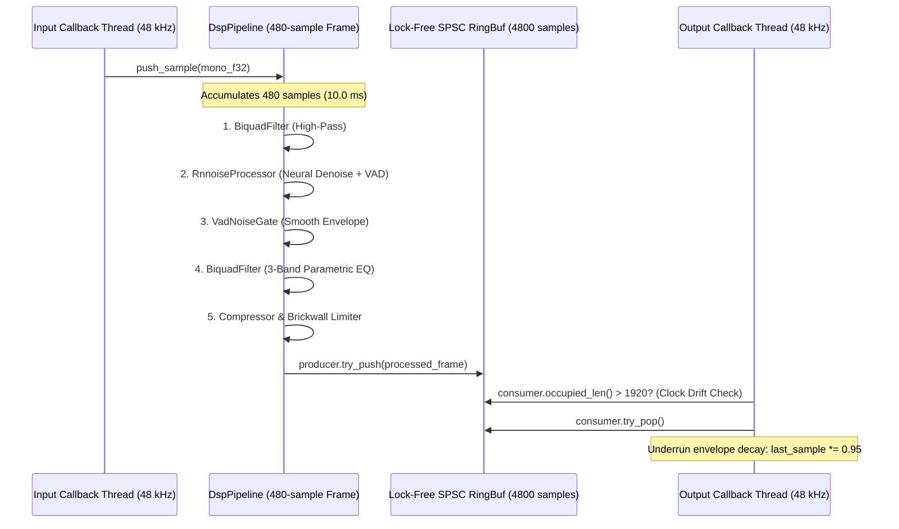

# Software Architecture Description (AD)
**Standard:** ISO/IEC/IEEE 42010:2022 (*Systems and software engineering — Architecture description*) & IEEE 1016 (*Software Design Descriptions*)  
**Document ID:** `AD-FIFINE-001`  
**Version:** `1.0.0`  
**Status:** Approved

---

## 1. Introduction and System Identification

### 1.1 Purpose
This Architecture Description (AD) defines the structural, behavioral, and real-time concurrency design of the **FIFINE Open Audio Platform** — a cross-platform real-time Digital Signal Processing (DSP) companion system for USB Audio Class (UAC) microphones (including **FIFINE K689**, **K688**, **AM8**, **K669**, and third-party devices).

### 1.2 Scope
The system captures raw PCM streams from physical audio endpoints, executes deterministic real-time voice processing (High-Pass filtering, recurrent neural network denoising, Voice Activity Detection gating, 3-band parametric equalization, dynamic compression, and brickwall limiting) with zero heap allocations on the audio thread, and routes the processed stream to a virtual audio endpoint under **Windows (WASAPI)** and **Linux (PipeWire / ALSA)**.

---

## 2. Stakeholders and Architecture Concerns

In accordance with ISO/IEC/IEEE 42010 Clause 5.3, the following stakeholders and their architecture concerns are established:

| ID | Stakeholder | Architecture Concerns |
| :--- | :--- | :--- |
| **SH-01** | End User (Streamer, Podcaster, Audio Engineer) | **C-01:** Low end-to-end round-trip latency ($\le 25\text{ ms}$).<br>**C-02:** Zero buffer underrun/overrun artifacts (clicks, pops, xruns).<br>**C-03:** Automatic hardware profile matching (e.g., K689 condenser vs. K688 dynamic). |
| **SH-02** | DSP Plugin Contributor | **C-04:** Ability to inject custom DSP nodes (`DspNode`) into the processing pipeline via Dependency Injection without modifying the core audio engine (Open-Closed Principle). |
| **SH-03** | Hardware Profile Maintainer | **C-05:** Declarative registration of new microphone models and acoustic presets within the domain registry without altering infrastructure adapters. |
| **SH-04** | OS Systems Integrator | **C-06:** Strict isolation of platform-specific audio backends (WASAPI, PipeWire, ALSA) behind domain ports (Hexagonal Architecture). |

---

## 3. Architecture Viewpoints

The architecture is specified through three complementary viewpoints:
1. **Domain & Logical Viewpoint:** Defines the Domain-Driven Design (DDD) core entities, value objects, ports (traits), and Dependency Inversion boundaries.
2. **Real-Time Concurrency & Dataflow Viewpoint:** Specifies thread boundaries, lock-free Single-Producer Single-Consumer (SPSC) synchronization, frame alignment, and clock drift compensation.
3. **Component & Workspace Viewpoint:** Maps logical modules onto physical Rust Cargo workspace crates.

---

## 4. Architecture Views

### 4.1 Domain & Logical View (DDD + Ports & Adapters)

The platform enforces strict Dependency Inversion:
- **`fifine-domain`** is a pure domain crate with zero dependencies on OS audio drivers or external DSP libraries.
- **`fifine-dsp`**, **`fifine-hal`**, and **`fifine-engine`** act as infrastructure adapters that implement or consume domain ports (`DspNode`, `ProfileRepositoryPort`, `DeviceDiscoveryPort`).



### 4.2 Real-Time Concurrency & Dataflow View

The audio engine operates across two asynchronous high-priority OS audio threads bridged by a wait-free SPSC ring buffer (`ringbuf::HeapRb<f32>`).



#### Real-Time Safety Invariants
1. **RT-INV-01 (Zero Heap Allocation on Audio Threads):** All dynamic structures (`Vec<Box<dyn DspNode>>`, `DenoiseState`, `HeapRb<f32>`) are pre-allocated during the build phase before starting audio streams. Invocations of `malloc`, `free`, or dynamic resizing inside `DspNode::process_frame` are strictly prohibited.
2. **RT-INV-02 (Lock-Free Execution):** Audio callbacks must never acquire blocking synchronization primitives (`Mutex`, `RwLock`, `Condvar`) or perform I/O system calls. Telemetry is exported exclusively via atomic registers (`AtomicUsize`, `AtomicU32`) using `Ordering::Relaxed`.
3. **RT-INV-03 (Bounded Clock Drift):** Hardware clock skew between the USB microphone crystal oscillator and the output device is bounded by monitoring ring buffer occupancy. If occupancy exceeds `4 * 480` samples (`40 ms`), the consumer skips one frame (`480` samples) to prevent latency accumulation.

### 4.3 Domain Acoustic Profile Specifications

| Profile ID | Hardware Model | Capsule Type | HPF (Hz) | VAD Gate (%) | Low-Mid EQ | Presence EQ | High-Shelf EQ | Compressor |
| :--- | :--- | :--- | :--- | :--- | :--- | :--- | :--- | :--- |
| **`k689`** | FIFINE K689 | Condenser | 85.0 | 35% | 240 Hz (-2.0 dB) | 3200 Hz (+1.5 dB) | 9500 Hz (+0.5 dB) | -20 dB (3.0:1) |
| **`k688`** | FIFINE K688 | Dynamic | 75.0 | 20% | 300 Hz (-3.0 dB) | 3800 Hz (+2.5 dB) | 10000 Hz (+2.0 dB) | -18 dB (3.5:1) |
| **`am8`** | FIFINE AmpliGame AM8 | Dynamic | 80.0 | 25% | 260 Hz (-2.5 dB) | 3500 Hz (+2.0 dB) | 10500 Hz (+1.8 dB) | -19 dB (3.2:1) |
| **`k669`** | FIFINE K669 / K669B | Condenser | 90.0 | 40% | 250 Hz (-1.5 dB) | 3000 Hz (+1.0 dB) | 9000 Hz (-1.0 dB) | -21 dB (3.0:1) |

---

## 5. Architecture Decision Records (ADRs)

### ADR-001: Fixed 480-Sample (10 ms @ 48 kHz) Frame Alignment
- **Context:** The RNNoise recurrent neural network (`nnnoiseless`) requires fixed 480-sample STFT frames at 48,000 Hz, whereas OS audio callbacks deliver variable buffer lengths.
- **Decision:** `DspPipeline` maintains a fixed stack-allocated buffer `[f32; 480]` that accumulates incoming samples and triggers the `DspNode` chain deterministically every 480 samples.
- **Consequences:** Introduces a deterministic 10.0 ms algorithmic latency while guaranteeing uniform frame sizes for all downstream `DspNode` implementations.

### ADR-002: Internal 16-Bit Amplitude Scaling for RNNoise
- **Context:** `cpal` operates on normalized IEEE 754 `f32` samples in `[-1.0, +1.0]`, whereas RNNoise weights expect 16-bit integer-scaled floats in `[-32768.0, +32767.0]`.
- **Decision:** `RnnoiseProcessor` encapsulates the `* 32768.0` pre-scaling and `/ 32768.0` post-scaling internally, preserving the standard `[-1.0, +1.0]` contract across all other `DspNode` components.

---

## 6. Extensibility Specification

### 6.1 Injecting a Custom DSP Node
Developers can extend the audio pipeline by implementing `fifine_domain::DspNode` and injecting it via `DspPipelineBuilder::with_node`:

```rust
use fifine_domain::{DspNode, ProcessContext};

pub struct CustomDeEsser {
    enabled: bool,
}

impl DspNode for CustomDeEsser {
    fn name(&self) -> &'static str {
        "Custom De-Esser"
    }

    fn process_frame(&mut self, samples: &mut [f32], _ctx: &mut ProcessContext) {
        if !self.enabled {
            return;
        }
        for s in samples.iter_mut() {
            *s = *s;
        }
    }
}
```

### 6.2 Registering a New Microphone Profile
New hardware models can be added at runtime via `InMemoryProfileRegistry::register_profile()` or statically appended to `BUILTIN_PROFILES` in `crates/fifine-domain/src/profiles.rs`.
